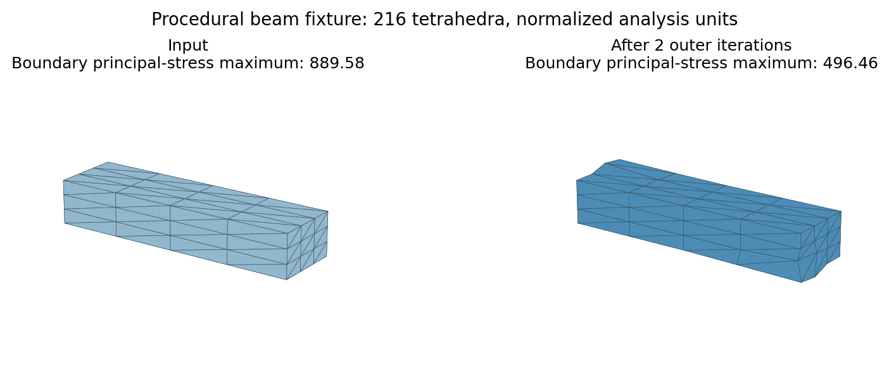

# Worst-Case Non-parametric Shape Optimization

This repository contains the C++ implementation accompanying **Worst-Case
Non-parametric Shape Optimization**. Given a watertight, self-intersection-free
3D shape, the method changes surface vertex positions directly to reduce
worst-case structural stress while preserving the shape and maintaining a
valid volume mesh.



The method uses an approximate bilevel optimization. An inner finite-element
analysis searches for a critical surface-normal load with a sparse generalized
eigenvalue solve. An outer optimization updates the surface using a smoothed
stress barrier, collision and element-flip barriers, point-to-surface shape
fidelity, and locality-aware surface smoothing. Warm starts, line search,
periodic mesh improvement, and checkpoints make the solver practical on
moderate-size meshes.

## Paper

Yu Xing, Xiaoxuan Wang, Zherong Pan, Xifeng Gao, and Lin Lu. 2027.
*Worst-Case Non-parametric Shape Optimization*. ACM Transactions on Graphics
46(2), Article 17. DOI: [10.1145/3841629](https://doi.org/10.1145/3841629).

The paper describes the motivation, formulation, algorithm, and evaluation.
The source tree also includes the implementation decisions and validation
record used for this release:

- [`docs/implementation_notes.md`](docs/implementation_notes.md) records
  intentional paper/code differences and numerical conventions.
- [`docs/parameters.md`](docs/parameters.md) documents every configuration key.
- [`docs/validation.md`](docs/validation.md) records local tests and their
  scope.

## Features

- Direct, non-parametric optimization of surface vertices on general 3D meshes.
- Worst-case load analysis with finite elements and three candidate generalized
  eigenmodes, selecting the mode with the largest compliance.
- Two-phase optimization that prioritizes the maximal absolute principal stress
  before shape-fidelity and smoothing objectives.
- Self-intersection and tetrahedron-flip barriers, with boundary-aware MMG3D
  mesh improvement between outer iterations.
- Deterministic seeded sampling, JSON configurations, progress history, and
  resumable checkpoints.
- Optional fTetWild-based tetrahedralization for surface inputs.

## Requirements

The standard build requires:

- CMake 3.20 or newer;
- a C++17 compiler;
- a working network connection for the first CMake configure, which fetches
  pinned third-party dependencies;
- Python 3 for the integration tests and helper scripts. The plotting helper
  additionally requires `matplotlib`; the optional formatting check requires
  `clang-format`.

OpenMP is enabled when available. The optional surface-input adapter requires
`WCSO_WITH_TETWILD=ON` and an externally available GMP installation. A core
build without fTetWild accepts `.mesh` and ASCII Gmsh `.msh` volume meshes.
The default CMake configuration fetches pinned versions of Eigen, Spectra,
AMGCL, nlohmann/json, libigl, IPC Toolkit, and MMG3D.

## Build

From the repository root:

```sh
cmake -S . -B build \
  -DCMAKE_BUILD_TYPE=Release \
  -DWCSO_WITH_OPENMP=ON \
  -DWCSO_BUILD_TESTS=ON
cmake --build build --config Release -j
```

The executable is normally `build/bin/wcso` (on a multi-configuration
generator it may be under `build/bin/Release/`). To build only the main program
and numerical tests:

```sh
cmake --build build --config Release --target wcso wcso_tests -j
```

To build surface-input support, configure a separate build and provide GMP
through your package manager or toolchain:

```sh
cmake -S . -B build-surface \
  -DCMAKE_BUILD_TYPE=Release \
  -DWCSO_WITH_TETWILD=ON \
  -DGMP_INCLUDE_DIRS=/path/to/gmp/include \
  -DGMP_LIBRARIES=/path/to/gmp/lib/libgmp.dylib
cmake --build build-surface --config Release -j
```

The exact GMP library path is platform-dependent. Keep the default `OFF` when
you already have a tetrahedral volume mesh.

## Quick start

The included beam is a small procedural volume-mesh example with 80 vertices
and 216 tetrahedra. A short smoke run exercises both optimization phases:

```sh
./build/bin/wcso \
  --input data/beam.mesh \
  --output runs/beam-smoke \
  --config configs/smoke.json \
  --threads 1
```

The output directory must be new or empty. The command writes the effective
configuration and normalization, progress history, a checkpoint, the final
surface and volume meshes, and a summary. `data/beam.obj` is the boundary
surface extracted from the same example.

For a single worst-case analysis without shape optimization:

```sh
./build/bin/wcso \
  --input data/beam.mesh \
  --output runs/beam-analysis \
  --config configs/smoke.json \
  --analyze-only
```

The analysis result is saved as `analysis.json`.

## Inputs and outputs

The command-line interface is:

```text
wcso --input MODEL.{obj,ply,stl,mesh,msh} --output DIR [--config FILE]
     [--threads N] [--seed N] [--solver cg|gcr] [--save-every N] [--debug]
     [--outer-iterations N] [--inner-iterations N] [--analyze-only]
wcso --resume CHECKPOINT.json --output NEW_DIR [--outer-iterations N]
```

`.mesh` and `.msh` inputs must contain linear tetrahedra. OBJ, PLY, and STL
surface inputs require a build with fTetWild enabled and must be watertight and
self-intersection-free. All inputs are translated and scaled so that the
longest side of the bounding box is one; the inverse transform is stored in
`normalization.json` and applied to exported meshes.

A normal optimization run produces:

| Path | Contents |
| --- | --- |
| `config_used.json` | Every effective numerical parameter, including defaults. |
| `normalization.json` | Input offset, scale, and stress-unit convention. |
| `generated_input.mesh` | Generated volume mesh when the input was a surface. |
| `history.csv` | Initial analysis, optimization steps, remeshing events, and final analysis. |
| `checkpoint.json` | Resumable solver state, written at the configured interval. |
| `snapshots/` | Optional surface snapshots when `save_every > 0`. |
| `final.obj` | Optimized surface mesh in the input coordinate system. |
| `final.mesh` | Optimized tetrahedral volume mesh in the input coordinate system. |
| `summary.json` | Final stress, shape-deviation, quality, runtime, and termination data. |

Resume a run from its latest checkpoint with the same numerical parameters:

```sh
./build/bin/wcso \
  --resume runs/beam-smoke/checkpoint.json \
  --output runs/beam-resumed \
  --outer-iterations 20
```

The CLI rejects incompatible numerical settings when resuming. The execution
thread count, output intervals, and debug logging may be changed through the
effective configuration; the saved numerical parameters must remain unchanged.

## Configuration and reproducibility

`configs/smoke.json` is intentionally small and is useful for a quick check.
`configs/paper.json` contains the author-approved settings used for the release
configuration. Important defaults include Lamé parameters `lambda = 1` and
`mu = 0.3`, `gamma = 0.5`, `outer_iterations = 1000`,
`inner_iterations = 5`, `epsilon_d = 1e-4`, `quality_threshold = 0.1`, and
`seed = 1`.

Every effective value is written to `config_used.json`. Command-line options
override the JSON file. See [`docs/parameters.md`](docs/parameters.md) for
units, valid ranges, and the full parameter table.

The released implementation is an author-approved corrected implementation,
not a promise of byte-for-byte reproduction of every experiment in the paper.
For example, it uses Spectra rather than ARPACK, three candidate eigenpairs,
a current-geometry null-space penalty, and MMG3D mesh improvement. These
choices, together with the validation scope and known limitations, are
documented in [`docs/implementation_notes.md`](docs/implementation_notes.md)
and [`docs/validation.md`](docs/validation.md).

## Tests and helper scripts

Run the C++ and Python tests after building:

```sh
ctest --test-dir build --build-config Release --output-on-failure
python3 scripts/check_source.py
# Optional, when clang-format is installed:
python3 scripts/check_source.py --format
```

The integration test covers the CLI, both projected linear solvers, seeded
parallel execution, normalization, checkpoint/resume, supported mesh readers,
invalid-input handling, and regression values for the beam fixture.

To regenerate the example assets:

```sh
python3 scripts/generate_example.py
```

For authorized input models, run a batch and collect comparable statistics:

```sh
python3 scripts/run_benchmarks.py \
  --exe ./build/bin/wcso \
  --models /path/to/model1.mesh /path/to/model2.mesh \
  --output runs/benchmarks \
  --config configs/paper.json \
  --threads 1 \
  --solver gcr
```

Then plot the recorded histories:

```sh
python3 scripts/reproduce_figures.py --runs runs/benchmarks
```

The benchmark helper does not download or redistribute paper benchmark assets.
Supply only models for which you have redistribution permission.

## Limitations

The solver is an approximate alternating bilevel method without a general
convergence guarantee. Runtime grows more than linearly with mesh resolution,
and very high-resolution or numerically ill-conditioned inputs may fail. The
stress/fidelity trade-off is controlled by configuration weights and normalized
units, so results are application-dependent. The included tests validate the
implementation and fixtures; they do not establish that every published
experiment or physical 3D-printing result can be reproduced from this source
package.

## Citation

If you use this code or method in academic work, please cite:

```bibtex
@article{xing2027worstcase,
  author  = {Xing, Yu and Wang, Xiaoxuan and Pan, Zherong and Gao, Xifeng and Lu, Lin},
  title   = {Worst-Case Non-parametric Shape Optimization},
  journal = {ACM Transactions on Graphics},
  volume  = {46},
  number  = {2},
  articleno = {17},
  year    = {2027},
  month   = apr,
  doi     = {10.1145/3841629}
}
```

## License and third-party notices

The project-authored source code and original procedural example assets in this
repository are licensed under the MIT License; see [`LICENSE`](LICENSE). Third-party
dependencies remain under their respective licenses. Their notices are kept in
[`licenses/`](licenses/), and the MIT License does not relicense those
dependencies or any separately licensed paper artwork or data.
